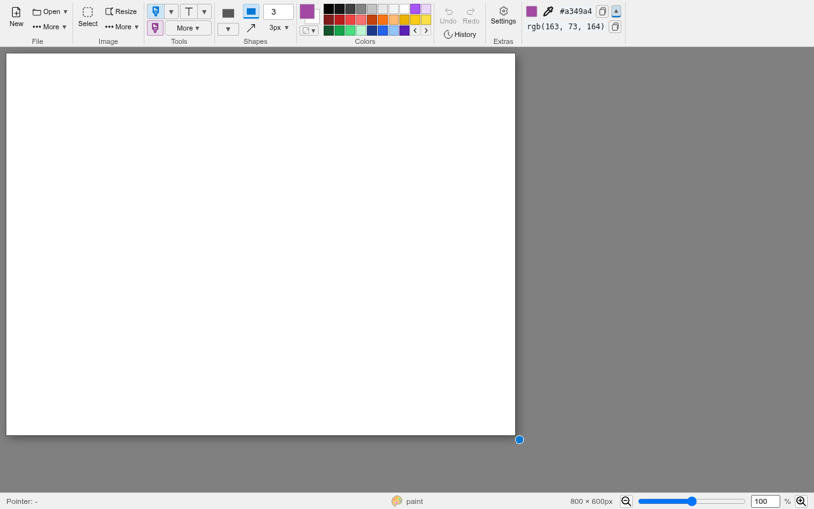

# Paint Online

Paint is a local-first image editor for the browser, built with plain
JavaScript ES modules and browser APIs. No account is required. The source
shell runs directly in a browser; an optimized static build is also available.



## Run locally

Serve the repository over HTTP; opening `index.html` as a `file://` URL will
block ES module imports.

```bash
python3 -m http.server 8000
```

Open `http://localhost:8000`. For the optimized build and test commands, use
Node.js 24 or newer:

```bash
npm install
npm test
npm run build
```

## What it does

- Raster drawing, shapes, text, selections, transforms, and image adjustments.
- Browser clipboard support, undo/redo, and image import/export.
- Local settings, optional working-canvas recovery, and separate image/session
  history.
- Installable offline shell on supported browsers.

Images and settings are handled in the browser. Paint uses IndexedDB for the
working-canvas recovery record and cross-refresh image history, and
`localStorage` for small settings and compatibility fallbacks. Clipboard access
happens only when a user invokes a clipboard action. See the [architecture and
data-flow guide](./docs/architecture/overview.md) for what each store owns.

## Project guide

| Start here | For |
|---|---|
| [Documentation index](./docs/README.md) | Map to architecture, guides, ADRs, reports, and community docs |
| [Architecture](./docs/architecture/overview.md) | Source map, UI/action flow, persistence, and trust boundaries |
| [Project audit](./docs/reports/project-audit.md) | Strengths, evidence-based gaps, and recommended work order |
| [Local browser tests](./tests/SKILL.md) | Deterministic desktop/mobile checks before handoff |
| [Contributing](./CONTRIBUTING.md) | Local checks and human-reviewed AI-assisted contributions |
| [Security policy](./SECURITY.md) | Private vulnerability reporting guidance |
| [Community standards](./docs/community/standards.md) | Repository files and maintainer decisions |

The contributor workflow and focused code checks are in
[`CONTRIBUTING.md`](./CONTRIBUTING.md). The project does not currently
declare an open-source license; that remains a maintainer decision.

## Browser and release notes

Paint depends on browser-native canvas, clipboard, file, storage, and service
worker APIs. Feature availability varies by browser; for example, saving back
to a chosen file may use the File System Access API where supported and a
download elsewhere. The app remains usable without that API.

For versioned releases, run `npm run version:patch` (or the appropriate npm
version command) and follow [the release guide](./docs/guides/releasing.md).
Do not edit the service-worker cache name or shell list by hand.
