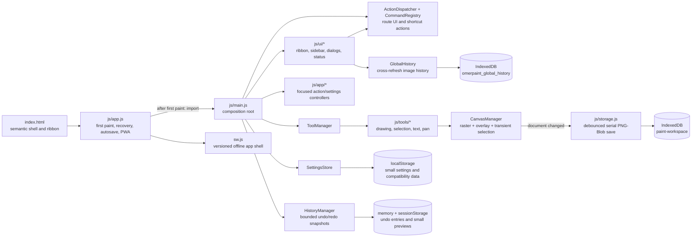
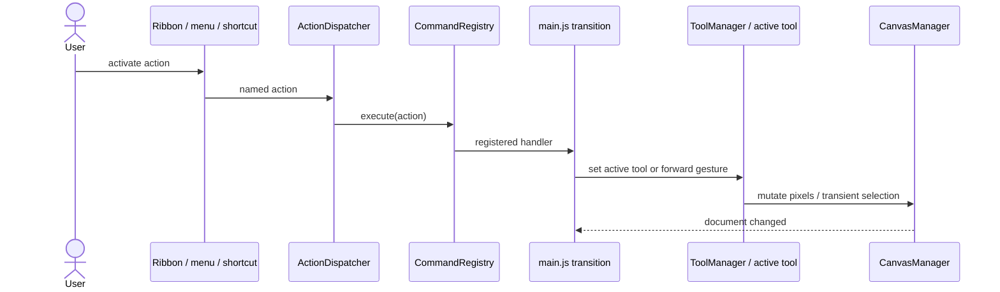

# Architecture and data flow

Paint is a browser application, not a server-rendered service. The HTML shell
is useful before the editor module graph finishes loading; `js/app.js` then
loads and coordinates the editor runtime in `js/main.js`.

## Runtime map

**How to read it:** the UI dispatches intent; managers and services own state
and persistence; the canvas manager owns raster pixels. The overlay and
floating selection are transient editing surfaces, not saved image pixels
until the selection is committed.

## Persistence: three different jobs

| Data | Owner | Storage and limits | Purpose |
|---|---|---|---|
| Undo/redo | `js/history/HistoryManager.js` | In-memory PNG Blobs/object URLs; at most 20 entries, 64 MiB total, and 16 Mi pixels per snapshot | Fast editing history for the current page |
| Working canvas | `js/storage.js` | IndexedDB Blob; debounced serial writes, 16 Mi-pixel autosave ceiling, 24-hour age limit | Restore the last working image when the recovery preference is enabled |
| Cross-refresh image history | `js/history/GlobalHistory.js` | Separate IndexedDB store, newest-first, user-configurable count and browser-quota trimming | Explicitly saved image versions across reloads |
| Settings | `js/settings/SettingsStore.js` | Versioned `localStorage` record | Small preferences and UI state |
| Session preview backup | `HistoryManager` | Small thumbnails in `sessionStorage` | Rebuild the current session list after a refresh; not a full-resolution undo store |

These are deliberately not one generic “history.” A blank, unchanged document
should not create a user-visible image-history or session entry. Canvas
autosave and saved image history are separate features with separate controls.

## Source map

| Path | Responsibility |
|---|---|
| `js/app.js` | First-paint boundary, lazy editor startup, canvas recovery/autosave, telemetry, service-worker update checks |
| `js/main.js` | Composition root: constructs collaborators and connects shared actions, tools, UI, and settings |
| `js/app/` | Focused controllers for commands, settings, file actions, selection, history, resize, and routing |
| `js/canvas/` | Raster document, canvas sizing, viewport geometry, and adjustment services |
| `js/tools/` | Pointer-driven tool behavior; tools receive the shared canvas and tool context |
| `js/ui/` | Ribbon, sidebar, dialogs, tabs, mirrors, and status components |
| `js/history/`, `js/storage.js` | Undo/session history, cross-refresh image history, and working-canvas persistence |
| `js/settings/`, `js/core/` | Settings contracts, event bus, shared constants, and document contracts |
| `js/document/`, `js/session/` | Editable text/document and workspace-session foundations; consult their contracts before extending them |
| `js/background/`, `js/ai/` | Optional background-removal providers and deterministic command/connection seams |
| `css/` | Theme, component, and progressive styles |
| `tests/` | Node contracts plus a portable CDP core, Paint adapter, and local desktop/mobile browser specs |
| `scripts/` | Build, service-worker synchronization, release, localization, and audit gates |

## UI and command flow

The menu's HTML/accessible label is the UI surface; command ownership is shared
with keyboard shortcuts and canvas context menus. Add one action name to the
shared constants and route the behavior through the command registry instead
of duplicating transitions in each surface.

## Search and component discovery

There is no Storybook or standalone visual component workbench today. Current
search is purpose-specific: settings/dialog search and searchable shape
catalogs are implemented by their owning UI modules. Use
[`UI patterns`](../guides/ui-patterns.md) as the current interaction catalog.
Recommended next step: add a small local UI gallery that renders existing
components and states from their real implementations, rather than copying
markup or installing a framework that creates a second source of truth.

## Trust boundaries

- Paint does not require an account or provider API key for ordinary editing.
- The service worker caches the application shell, not the user's saved
  canvas records.
- Images in autosave and history remain in the browser's origin-scoped
  IndexedDB. Browser storage is not encrypted or a secret vault.
- Clipboard reads/writes and file access are browser capabilities invoked by
  explicit user actions.
- Optional integrations must document any data sent outside the browser before
  they are enabled; do not put credentials in source or browser storage.

For the reason behind each boundary and the current quality priorities, see
the [audit and roadmap](../reports/project-audit.md).
