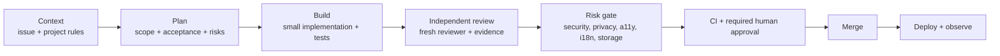

# Project status and improvement plan

**Reviewed:** 2026-11-21 · **Repository version:** 1.9.1
This is a repository/source review, not a claim of full browser, device, or
Lighthouse certification. Exact commands and the final results from this
change are recorded at handoff.

## At a glance

| Area | Current status | What it means |
|---|---|---|
| Editor core | Strong foundation | Plain ES modules; canvas pixels, transient overlays, tools, and UI have named owners |
| Local data | Separate bounded stores | Undo, working-canvas recovery, explicit image history, and settings are distinct |
| Validation | Useful, with a hardened browser baseline | 418 Node tests plus two local Chromium journeys; browser coverage is initial and not in CI |
| Onboarding | Improved | README, documentation index, ADRs, and audit now point to the current structure |
| Visual discovery | Missing | No component gallery/Storybook; reusable patterns are documented but not browsable as live examples |
| Mobile workflow | Needs focused validation | A touch/brush smoke test exists; pan visibility, navigation, and location context still need deliberate mobile journeys |
| Architecture scale | Incremental work needed | The app is modular, but the composition root and some UI modules remain large |
| Launch evidence | Incomplete | Local Chromium smoke tests help, but do not replace broad browser, physical-device, or production Lighthouse evidence |
| Licensing | Owner decision | No `LICENSE` file; do not describe the repository as licensed open source until the maintainer decides |

## What is already good

- **Pixels have an owner:** `CanvasManager` owns the raster surface; overlays and
  floating selections are kept separate until commit.
- **Changes flow through seams:** tool manager, action dispatcher, command
  registry, settings stores, and focused UI controllers keep much of the
  application testable without a framework.
- **Storage is not one giant snapshot:** working-canvas recovery uses a bounded
  IndexedDB Blob record; undo uses capped Blob snapshots; explicit cross-refresh
  image history is a separate store; settings remain small.
- **Memory limits exist:** undo is capped by count, bytes, and per-snapshot
  pixels; autosave and image admission have independent size checks.
- **The release path is reproducible:** service-worker assets are generated
  from the module graph, versions are synchronized, and checks cover tests,
  localization, syntax, docs, and release metadata.
- **A local browser baseline now exists:** `npm run test:local` runs the
  existing Node suite and desktop/mobile-emulated Chromium checks through a
  small CDP harness, without adding browser-test npm dependencies or changing
  CI. Its current feature coverage is intentionally narrow.
- **No credentials are required for ordinary local editing.** Clipboard and
  file-system access are browser APIs and should remain explicit user actions.

See [Architecture and data flow](../architecture/overview.md) for the visual source and
storage map.

## Findings and recommended order

### A. Reliability fixes in this change

| Finding | Status | Evidence / next check |
|---|---|---|
| Manual history actions could save an untouched blank canvas or repeat the same snapshot | Fixed and verified | Focused tests pass; in a fresh browser context, global History stayed empty and Session stayed at its Current preview after both Save Current actions |
| There was no visible action to leave selection mode | Fixed and verified | Localized Deselect appears in the Image > Selection submenu and canvas context menu; a 200×150 selection cleared and the previous Brush tool returned |
| First service-worker control could trigger the same unconditional reload as an update | Fixed and verified locally | Fresh origin reported one navigation of type `navigate` and reached ready state; production update behavior still needs a separate deployment check |
| The public audit, README links, and docs consistency check were stale | Fixed | Current docs replace obsolete scores/claims; docs gate checks public links and optional local internal docs |
| README screenshot showed an obsolete UI | Fixed | Replaced with a current 1280×800 local browser capture |
| Local deterministic browser checks were missing | Added | `npm run test:local` checks desktop app/brush behavior and mobile touch/brush behavior; it remains outside GitHub Actions |
| Process cleanup, session isolation, external-network policy, and active-tool assertion were missing from the initial harness | Fixed | Shared SIGTERM/SIGKILL cleanup, sessionStorage reset, loopback-only request policy, and Brush-active verification now cover the hardening findings |

The local release gates and initial desktop/mobile browser journeys pass.
Coverage of selection, resize, history, settings, and physical-device UX is
still separate work; production service-worker behavior and Lighthouse/field
performance also remain unverified.

## Agent guidance and hidden files

The tracked `AGENTS.md`, `.skills/`, and `.agents/skills/` are contributor
instructions and reusable workflows, not application runtime. They are
actively used by this project and should not be deleted just because they are
dot-directories. Keep the short project entry point, retain skills with a
current owner/use case, and consolidate overlap only after checking references.
No tracked `.github/agents/` configuration was found; do not describe the
current setup as an autonomous cloud merge/deploy system. `docs-internal/` is
ignored by Git and remains local working material.

### B. Recommended product and maintenance backlog

| Priority | Work | Why now | Done when |
|---|---|---|---|
| 1 | Expand browser regression coverage to selection/resize, history saves, settings, and narrow screens | The new suite currently covers only cold load and brush input | Deterministic journeys prove selection exit/resize, blank or duplicate saves, settings behavior, and narrow-screen layout without console errors |
| 2 | Mobile canvas ergonomics: make Hand/Pan and drawing/selection state unmistakable; assess a viewport minimap | A narrow canvas needs navigation without hiding the active mode | Touch journey is tested at 320–375 px; pan is easy to enter/exit; viewport position is understandable; desktop interaction remains unchanged |
| 3 | Build a lightweight UI gallery | A live, maintained gallery will make UI behavior easier to explain and regression-test than screenshots alone | Gallery uses actual components/controllers, has no copied state logic, and covers key, selected, disabled, open, RTL, and narrow states |
| 4 | Add configurable Quick Actions | Valuable customization, but depends on a clear action catalog and mobile/keyboard interaction rules | Users can add, reorder, remove, and reset actions; persistence is versioned; drag has a keyboard alternative; mirrors stay synchronized |
| 5 | Expand release notes into a visual, browsable feature history | Helps first-time users understand meaningful changes without relying on terse version bullets | About/release UI explains features with examples, works offline, and gets content from one versioned source |
| 6 | Continue measured modularization | `js/main.js`, `js/ui/Sidebar.js`, and `css/styles.css` are still large; avoid a rewrite without a measured seam | Each extraction has one owner, focused tests, no duplicated state, and a before/after maintenance benefit |

### C. AI-assisted contribution workflow

Use the following as a **human-reviewed process**, not an autonomous merge
promise:

The repository already has agent/project guidance, a PR template, CI checks,
release scripts, and testable architecture seams. The process should make the
evidence explicit at each PR; branch protection, required reviews, and
deployment permissions must be verified in GitHub settings rather than assumed.

[Google's Modern Web Guidance](https://github.com/GoogleChrome/modern-web-guidance)
is a useful optional reference for performance, accessibility, CSS, and
platform APIs. Adopt relevant recommendations selectively, then validate them
against Paint's own local-first behavior and project rules; do not install every
skill or replace the repository's existing governance by default.

## Documentation navigation

The concise [documentation index](../README.md) points to topic-based folders:
architecture, contributor guides, community standards, audit reports, and
architecture/testing ADRs. Keep `docs/` itself limited to that index; update
links and the index whenever a document moves.

## Verification results

| Check | Result |
|---|---|
| `npm run test:local` | PASS — 418 Node tests and 2 browser tests (desktop mouse + mobile touch) |
| `npm run check:i18n` | PASS — 8 locales, 563 keys, 410 UI labels |
| `npm run typecheck` | PASS |
| `npm run verify:docs` | PASS — 21 guides checked |
| `npm run audit:skills` | PASS — 7 valid skills, 2 recorded sessions |
| `npm run sw:check` | PASS — 150 shell assets, 141 app modules |
| `git diff --check` | PASS |
| `npm run verify:release` | PASS — version 1.9.1, 144 app JavaScript files, runtime and release checks |

### Browser evidence

`npm run test:local` ran against local headless Chromium: the 1280×800 desktop
journey loaded the editor and verified a brush stroke changed canvas pixels;
the 390×844 mobile-emulated journey verified touch input and a canvas pixel
change. The suite captured no failure screenshots.

Earlier manual evidence on local `http://127.0.0.1:4175/` showed a fresh-origin
visit navigated once and reached the ready editor without a second navigation.
Deselect cleared a
200×150 selection and restored Brush; both menu surfaces exposed Deselect.
“Save Current” on an untouched blank canvas added no global-history entry or
session snapshot. At 320×720, document width matched the viewport and the
browser reported zero warnings.

The background-only save case was source-verified but not directly exercised
through the browser because the swatch click was intercepted by an overlapping
control. Production service-worker update/reload behavior, physical-device
mobile interaction, Lighthouse, broad feature regression coverage, and
large-canvas performance remain untested; do not infer them from these local
checks.
