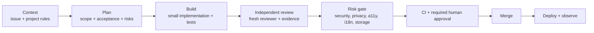

# Project status and improvement plan

**Reviewed:** 2026-11-21 · **Repository version:** 1.9.1
This is a repository/source review, not a claim of full browser, device, or
Lighthouse certification. Exact commands and the final results from this
change are recorded at handoff.

## At a glance

| Area | Current status | What it means |
|---|---|---|
| Editor core | Strong foundation | Plain ES modules; canvas pixels, transient overlays, tools, and UI have named owners |
| Local data | Separate bounded stores | Undo, working-canvas recovery, explicit image history, and settings are distinct |
| Validation | Useful, with a reporting browser harness | 400+ Node tests plus the current isolated local Chromium journeys; `npm test` prints the exact current Node count |
| Onboarding | Improved | README, documentation index, ADRs, and audit now point to the current structure |
| Visual discovery | Missing | No component gallery/Storybook; reusable patterns are documented but not browsable as live examples |
| Mobile workflow | Needs focused validation | A touch/brush smoke test exists; pan visibility, navigation, and location context still need deliberate mobile journeys |
| Architecture scale | Incremental work needed | The app is modular, but the composition root and some UI modules remain large |
| Launch evidence | Incomplete | Local Chromium smoke tests help, but do not replace broad browser, physical-device, or production Lighthouse evidence |
| Licensing | Owner decision | No `LICENSE` file; do not describe the repository as licensed open source until the maintainer decides |

## What is already good

- **Pixels have an owner:** `CanvasManager` owns the raster surface; overlays and
  floating selections are kept separate until commit.
- **Changes flow through seams:** tool manager, action dispatcher, command
  registry, settings stores, and focused UI controllers keep much of the
  application testable without a framework.
- **Storage is not one giant snapshot:** working-canvas recovery uses a bounded
  IndexedDB Blob record; undo uses capped Blob snapshots; explicit cross-refresh
  image history is a separate store; settings remain small.
- **Memory limits exist:** undo is capped by count, bytes, and per-snapshot
  pixels; autosave and image admission have independent size checks.
- **The release path is reproducible:** service-worker assets are generated
  from the module graph, versions are synchronized, and checks cover tests,
  localization, syntax, docs, and release metadata.
- **A local browser baseline now exists:** `npm run test:local` runs the
  existing Node suite and local Chromium journeys through a small CDP harness,
  without adding browser-test npm dependencies or changing CI. It covers
  desktop/mobile-emulated drawing, Clipboard text paste, rectangular
  selection, Deselect, and whole-canvas resize with Undo/Redo. It supports
  individual/group selection, fresh BrowserContexts, named steps, and per-run
  JSON/HTML reports; broader product coverage remains intentionally narrow.
  Direct CDP use is not a public, supported Chrome API and has no
  backwards-compatibility guarantee, so Chrome upgrades require a full-suite
  check.
- **No credentials are required for ordinary local editing.** Clipboard and
  file-system access are browser APIs and should remain explicit user actions.

See [Architecture and data flow](../architecture/overview.md) for the visual source and
storage map.

## Findings and recommended order

### A. Reliability fixes in this change

| Finding | Status | Evidence / next check |
|---|---|---|
| Manual history actions could save an untouched blank canvas or repeat the same snapshot | Fixed and verified | Focused tests pass; in a fresh browser context, global History stayed empty and Session stayed at its Current preview after both Save Current actions |
| There was no visible action to leave selection mode | Fixed and verified | Localized Deselect appears in the Image > Selection submenu and canvas context menu; a 200×150 selection cleared and the previous Brush tool returned |
| First service-worker control could trigger the same unconditional reload as an update | Fixed and verified locally | Fresh origin reported one navigation of type `navigate` and reached ready state; production update behavior still needs a separate deployment check |
| The public audit, README links, and docs consistency check were stale | Fixed | Current docs replace obsolete scores/claims; docs gate checks public links and optional local internal docs |
| README screenshot showed an obsolete UI | Fixed | Replaced with a current 1280×800 local browser capture |
| Local deterministic browser checks were missing | Added and extended | `npm run test:local` checks desktop/mobile drawing, Clipboard text paste, rectangular selection, Deselect, and whole-canvas resize/undo/redo; it remains outside GitHub Actions |
| Process cleanup, session isolation, external HTTP(S) policy, and active-tool assertion were missing from the initial harness | Fixed | Shared SIGTERM/SIGKILL cleanup, sessionStorage reset, external HTTP(S) blocking/recording, and Brush-active verification now cover the hardening findings; other transports are not claimed to be sandboxed |
| Local harness lacked test selection, centralized timeouts, isolated contexts, and structured reports | Fixed | `test:browser` supports stable IDs/groups, each test uses a new BrowserContext/process, config is validated centrally, and every run writes JSON/HTML plus diagnostics |
| Browser environment depended on host defaults | Fixed | Locale, timezone, color scheme, reduced motion, and DPR now have centralized deterministic defaults and per-spec overrides; both smoke journeys assert their emulated environment |
| SIGINT/SIGTERM during startup or an active browser-test process could skip cleanup/reporting | Fixed and verified | Server-startup cancellation unit test and manual Chrome-startup/browser-test-process probes returned exit 130, wrote interruption reports, and left no observed owned processes |
| Report persistence failure could hide already-collected test details | Fixed and unit-verified | Terminal test summary prints even when report files cannot be confirmed; log/result read failures are represented rather than thrown away |
| Full Chrome executable path could be copied to report metadata | Fixed | Reports now retain only executable basename and version |
| Failure evidence needed end-to-end proof | Verified and documented | A temporary, deliberately incorrect canvas-size assertion produced a failed step, screenshot, JSON/HTML, and exit code 1; the temporary test was removed and a sanitized example is linked from the test docs |
| Report writes and generated links needed stronger concurrency/path safety | Hardened and verified | Reports and `latest.json` are written via atomic rename; run IDs use full UUIDs; HTML links accept only safe relative artifact paths; concurrent Desktop/Mobile runs produced distinct valid reports and a valid latest pointer |
| Diagnostic URLs could preserve credentials or query secrets | Hardened and unit-verified | Network diagnostic URLs drop userinfo, query strings, and fragments; HTML escapes dynamic text and test paths |
| Reports needed predictable retention | Open maintenance decision | Artifacts are retained to preserve failure evidence; no automatic pruning currently exists |
| Direct CDP use has no compatibility guarantee | Accepted, documented trade-off | Keep the harness Chromium-only and run the full suite on Chrome upgrades; reassess supported options such as ChromeDriver only if maintenance becomes material |

The local release gates and focused desktop/mobile browser journeys pass.
Broader selection editing, settings, history, and physical-device UX remain
separate work; production service-worker behavior and Lighthouse/field
performance also remain unverified.

## Agent guidance and hidden files

The tracked `AGENTS.md`, `.skills/`, and `.agents/skills/` are contributor
instructions and reusable workflows, not application runtime. They are
actively used by this project and should not be deleted just because they are
dot-directories. Keep the short project entry point, retain skills with a
current owner/use case, and consolidate overlap only after checking references.
No tracked `.github/agents/` configuration was found; do not describe the
current setup as an autonomous cloud merge/deploy system. `docs-internal/` is
ignored by Git and remains local working material.

### B. Recommended product and maintenance backlog

Priority (impact/urgency) and effort are independent. Normally select one
Quick Win, one medium improvement, and one major initiative; work serially when
there are dependencies. Security, correctness, and release blockers override
the mix. These are candidates, not an instruction to start all three at once.

| Candidate | Priority | Effort | Category | Status | Dependencies | Acceptance criteria | Evidence / next gate |
|---|---|---|---|---|---|---|---|
| Verify Clipboard modifier behavior | P2 | S | Quality | Partially verified | Current local browser harness | Seed deterministic text with the browser Clipboard API, paste through a trusted keyboard event, and verify default Ctrl/Meta shortcut normalization | The browser journey uses Control+V on Linux; the Node test verifies Ctrl+V and Meta+V map to `mod+v`; native macOS paste remains unverified |
| Selection / Deselect / Resize browser journeys | P1 | M | Quality / Product | Verified locally (focused scope) | Current local browser harness | Assert rectangular bounds without raster mutation, Deselect and prior-tool restoration, plus 50% whole-canvas resize and pixel/dimension Undo/Redo | All three stable IDs pass individually and in default/reversed desktop order; mobile selection and selection-handle resizing remain open |
| Establish a separate performance baseline | P1 | L | Performance | Planned | Define repeatable measurement conditions; keep benchmarks separate from `test:local` | Record cold start, first interaction, large-canvas behavior (including 6000×6000), drawing latency, memory/history and storage growth with environment metadata; do not invent pass thresholds before a baseline | No current browser/performance baseline proves these limits; next gate is a measurement protocol and representative machine/browser record |

Keep the other existing roadmap areas visible: mobile Hand/Pan and narrow
canvas ergonomics; Settings, Zoom, Ribbon and Quick Actions; a UI Catalog and
Theme Studio; Layers as a future architecture initiative; portable UI
components and adapters; release-history presentation; and measured
modularization. The UI catalog and portable-package work must retain their
existing prerequisites; public npm/ZIP distribution remains blocked on the
maintainer's licensing decision and a stable consumer contract.

### C. Future browser coverage map

The rows below are coverage gaps, not a request to add a large suite now.
Chromium remains the only deterministic local browser baseline. The harness
uses CDP directly, which its documentation describes as unsupported for
third-party automation and not backward-compatible; this is a known maintenance
trade-off, not a cross-browser promise.

| Area | Verified today | Future coverage / next gate |
|---|---|---|
| Drawing and editing | Desktop/mobile-emulated Brush drawing; desktop rectangular selection, Deselect, and whole-canvas resize with Undo/Redo | Brush/eraser, selection movement/handles/lasso, transforms, mobile editing, blank/no-op and duplicate-history behavior |
| Persistence and storage | Existing code has separate settings, recovery, image-history and bounded undo paths; the smoke suite starts with an isolated browser context | Reload persistence for settings/palette/background, recovery/history restore, IndexedDB failures, quota exhaustion/recovery, high-resolution limits and cleanup |
| Browser APIs and offline | Local HTTP works; external HTTP(S) is blocked and recorded; text clipboard paste is verified in Chromium | Clipboard denied/unavailable and image-copy paths, import/export and File API fallback, service-worker install/update/reload, cached-shell and offline behavior |
| Mobile, input, and visual fidelity | 390×844 mobile emulation verifies touch drawing | 320–375 px layouts, Hand/Pan transitions, selection on touch, fullscreen, RTL, high DPR, browser zoom including true 200%, and pasted-image sharpness |
| Accessibility | No accessibility journey is part of the current smoke suite | Keyboard-only actions, focus visibility/restoration, dialogs, names/roles, error feedback, and non-pointer alternatives |
| Compatibility and performance | Chromium on the local environment only | Assess Firefox/WebKit and physical-device coverage against actual compatibility risk; measure cold start, first use, 6000×6000+ canvas, memory, history, storage, repeated drawing and imports in a separate benchmark command |

### D. AI-assisted contribution workflow

Use the following as a **human-reviewed process**, not an autonomous merge
promise:

The repository already has agent/project guidance, a PR template, CI checks,
release scripts, and testable architecture seams. The process should make the
evidence explicit at each PR; branch protection, required reviews, and
deployment permissions must be verified in GitHub settings rather than assumed.

Google's [Modern Web Guidance](https://developer.chrome.com/docs/modern-web-guidance/)
and its [source repository](https://github.com/GoogleChrome/modern-web-guidance-src)
are useful optional references for performance, accessibility, CSS, and
platform APIs. Adopt relevant recommendations selectively, then validate them
against Paint's own local-first behavior and project rules; do not install every
skill or replace the repository's existing governance by default.

## Documentation navigation

The concise [documentation index](../README.md) points to topic-based folders:
architecture, contributor guides, community standards, audit reports, and
architecture/testing ADRs. Keep `docs/` itself limited to that index; update
links and the index whenever a document moves.

## Verification results

| Check | Result |
|---|---|
| `npm run test:local` | PASS — 400+ Node tests and all current browser journeys; `npm test` prints the exact count |
| `npm run check:i18n` | PASS — locale catalogs and UI-label coverage verified |
| `npm run typecheck` | PASS |
| `npm run verify:docs` | PASS — documentation consistency verified |
| `npm run audit:runtime` | PASS — static contract census; not runtime teardown proof |
| `npm run sw:check` | PASS — service-worker shell is in sync |
| `npm run verify:release` | PASS — version 1.9.1 |
| `npm audit --audit-level=low` | PASS — 0 dependency vulnerabilities |
| `git diff --check` | PASS |

### Browser evidence

`npm run test:local` ran against local headless Chromium: the 1280×800 desktop
journey verified clean session storage before app scripts, active Brush
selection, and a canvas pixel change; the 390×844 mobile-emulated journey
verified active Brush selection and touch drawing. Locale/timezone/media
preferences and DPR are explicitly emulated and asserted. The desktop
Clipboard journey seeded text through the browser Clipboard API, pasted with
a trusted Control+V event on Linux, and verified that Paint opened its text
editor with the exact text. The shortcut-manager unit test confirms that Ctrl
and Meta both normalize to the default `mod+v` binding; native macOS browser
paste remains unverified.

The desktop feature journeys verify a 400×300 rectangular marquee at the
expected coordinates without changing raster pixels; Deselect clears the
handles and restores an explicitly selected Brush; and the 50% resize
preserves the drawn center pixel through resize, Undo, and Redo. Each journey
passed alone and the desktop group passed with the three feature journeys in
reverse order. The full local suite and diagnostics run include all current
journeys. The test guide and ADR retain the limitation to intercepted HTTP(S),
not a complete network sandbox.

A temporary controlled assertion expected 801×600 from Paint's normal
800×600 canvas and returned exit code 1 with a failed-step message, browser
diagnostics, screenshot, JSON report, and standalone HTML report. The
temporary test was removed. Sanitized successful and controlled-failure
reports plus actual screenshots are available in the
[test examples and visual gallery](../tests/examples/README.md). An invalid
`CHROME_BIN` also produced a structured infrastructure-failure report before
any browser test started.

Earlier manual evidence on local `http://127.0.0.1:4175/` showed a fresh-origin
visit navigated once and reached the ready editor without a second navigation.
Deselect cleared a
200×150 selection and restored Brush; both menu surfaces exposed Deselect.
“Save Current” on an untouched blank canvas added no global-history entry or
session snapshot. At 320×720, document width matched the viewport and the
browser reported zero warnings.

The background-only save case was source-verified but not directly exercised
through the browser because the swatch click was intercepted by an overlapping
control. Production service-worker update/reload behavior, physical-device
mobile interaction, Lighthouse, broad feature regression coverage, and
large-canvas performance remain untested; do not infer them from these local
checks.
