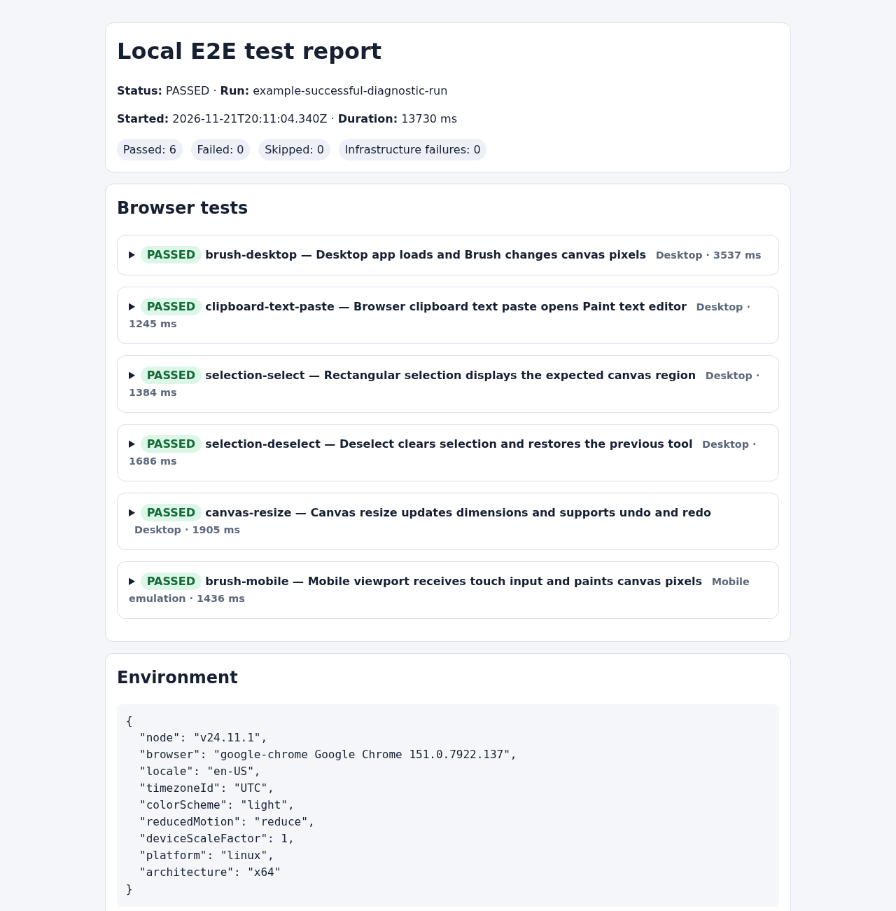
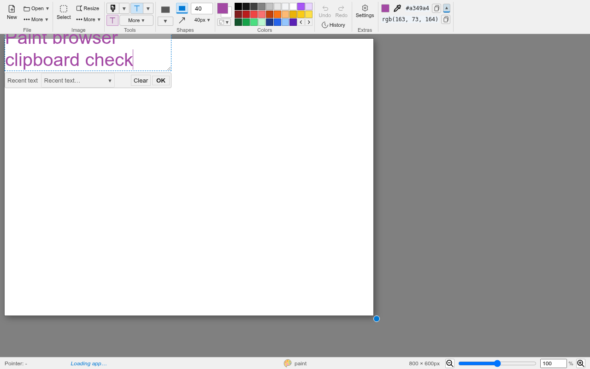
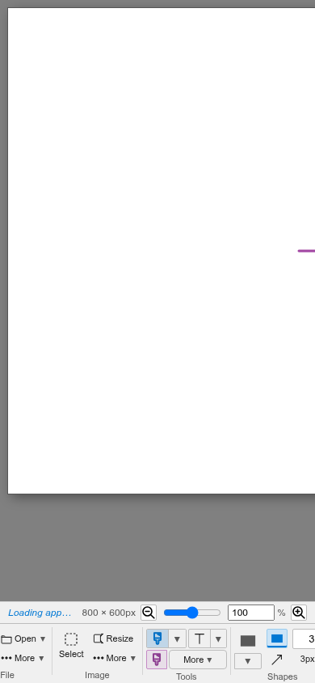
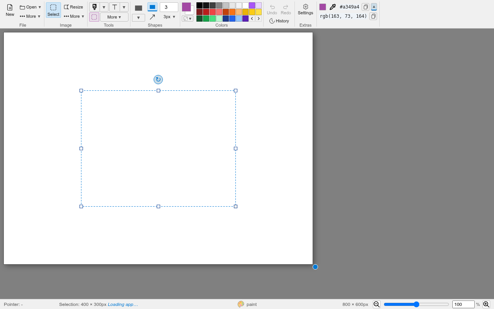
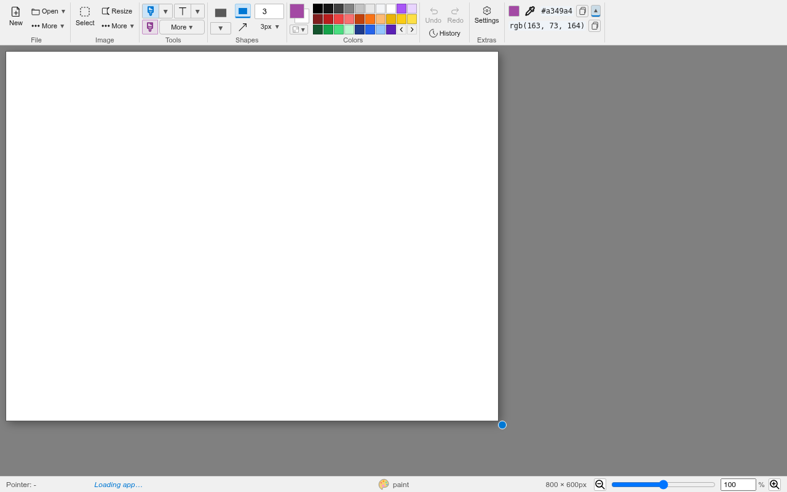
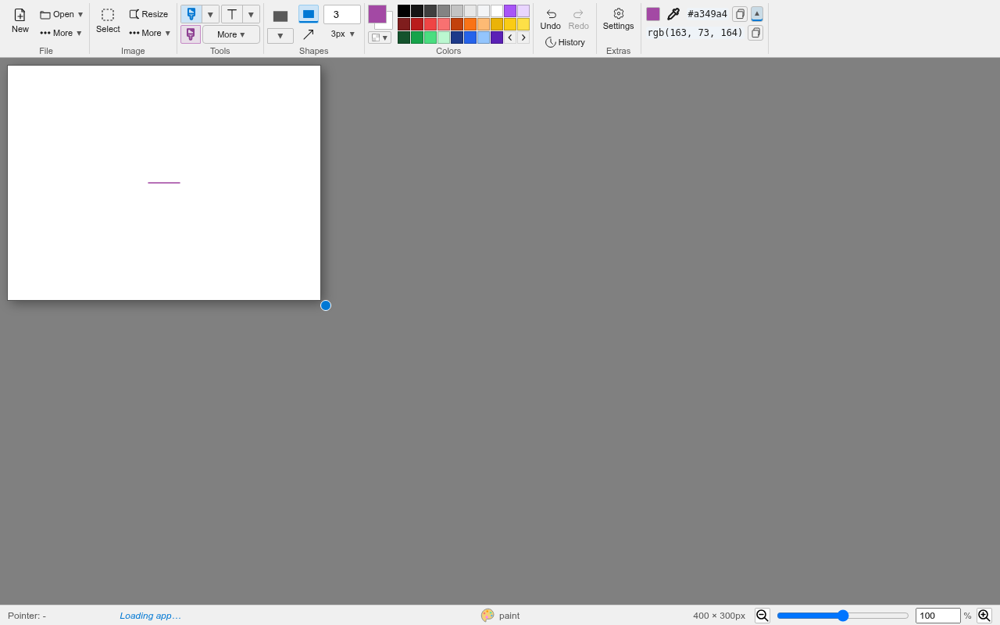

# Local browser-test examples

These are real, sanitized outputs from the local Chromium harness. The success
report shows the current report format; the controlled failure intentionally
asserts that Paint's normal 800×600 canvas is 801×600, so its failure is an
example of the reporting path, not a product defect.

## Copyable commands

```bash
npm run test:browser -- --list
npm run test:browser -- --test selection-select
npm run test:browser -- --test selection-deselect
npm run test:browser -- --test canvas-resize
npm run test:browser -- --diagnostics
npm run test:browser -- --rerun-failed latest
```

Copy a command from this code block with the Markdown viewer's copy control.
After a run, open `output/test-artifacts/latest.json` and follow its `html`
path relative to `output/test-artifacts/` to view the newest HTML report.

## Report overview

[Open the successful HTML example](./successful-browser-run.html) or inspect
its [JSON source](./successful-browser-run.json).



## Browser evidence gallery

The images below are actual browser screenshots from successful diagnostics
runs; they are not mockups.

### Brush and Clipboard

| Desktop Brush | Clipboard text paste |
|---|---|
|  |  |

### Mobile touch and Selection

| Mobile touch Brush | Rectangular selection |
|---|---|
|  |  |

### Deselect and Canvas resize

| Deselect | 50% canvas resize |
|---|---|
|  |  |

## Controlled failure

[Open the controlled-failure HTML example](./controlled-failure-browser-run.html)
or inspect its [JSON source](./controlled-failure-browser-run.json).


The failed assertion retains the failing step, expected/actual dimensions,
browser diagnostics, screenshot, and run metadata. The temporary example test
was removed from the permanent catalog after this report was generated.

